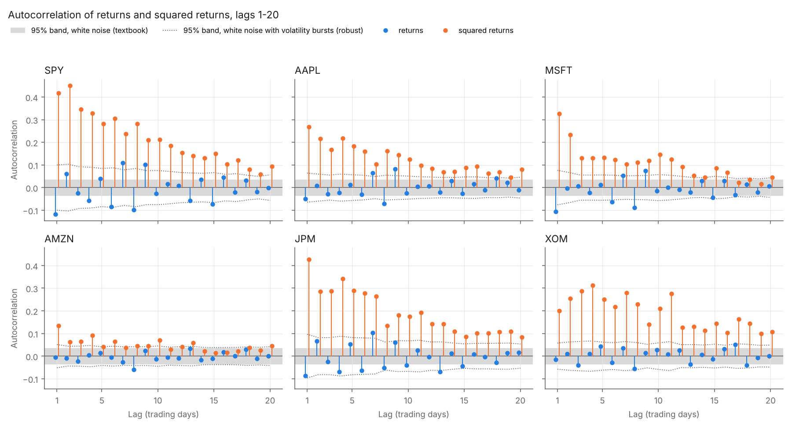
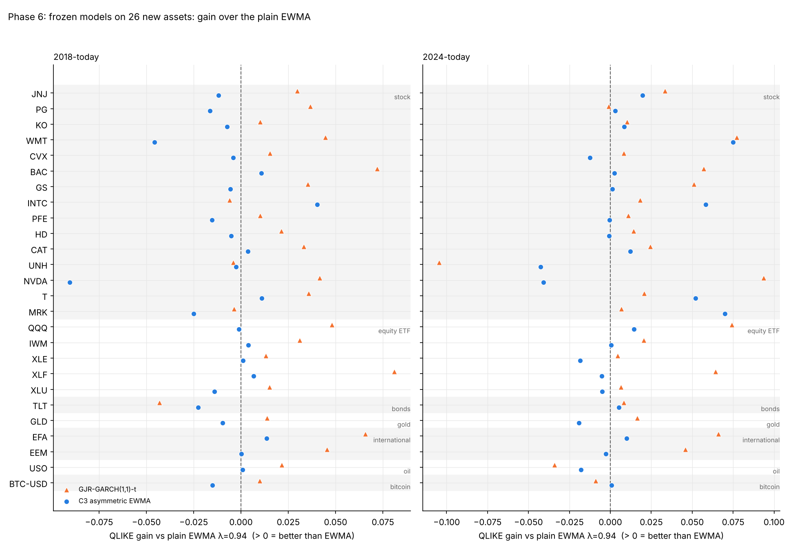

# SignalDesk

**Treating daily stock returns as a noisy signal, can we forecast how big tomorrow's
moves will be, and does that forecast actually help?**

The tools come from signal processing: spectra, low-pass filters and gain control.
Everything is explained in those terms first, then in finance terms. This is a
research project about *forecasting volatility*. It is not a trading system and
makes no claim to make money.

> **Two terms used throughout.** *Variance* is the noise power of daily returns.
> *Volatility* is its square root, the typical size of a daily move.

## Key findings

- **The direction of tomorrow's move is unpredictable, but its size is not.**
  - Daily returns have an almost flat spectrum, like white noise. Their lag-1
    autocorrelation is −0.04 to +0.02 once the Feb–Jun 2020 crash is excluded,
    and not significant.
  - Squared returns (the noise power) are strongly correlated from day to day:
    lag-1 autocorrelation is 0.13 to 0.43 for the six original tickers.
  - Sources: [`notes/phase1_summary.md`](notes/phase1_summary.md), [`figures/whiteness_tests.csv`](figures/whiteness_tests.csv).
- **A one-pole low-pass filter on squared returns forecasts volatility better than a constant, and GJR-GARCH does a little better still.**
  - The EWMA (λ = 0.94) beats a flat forecast out of sample on all six
    tickers. QLIKE gain is +0.030 to +0.200, and a shuffle test gives p = 0.005
    for every ticker ([`figures/vol_null_test.csv`](figures/vol_null_test.csv)).
  - GJR-GARCH(1,1)-t adds a mean QLIKE gain of +0.031 over the EWMA, with a
    pooled Diebold-Mariano t of −2.16, which is borderline
    ([`figures/benchmark_complexity.csv`](figures/benchmark_complexity.csv)).
- **Scaling position size by 1/forecast volatility did not beat buy-and-hold on a risk-adjusted basis (2022 to today).**
  - Sharpe was within ±0.06 of buy-and-hold for every ticker.
  - Drawdowns were smaller on every ticker, but a *constant* smaller position
    with the same volatility did about as well: on average +0.03 points of
    return per year, better on 3 of 6 tickers. The calmer ride came from
    holding less, not from timing.
  - Sources: [`notes/phase3_summary.md`](notes/phase3_summary.md), [`figures/placebo_verdict.csv`](figures/placebo_verdict.csv).
- **A pre-registered attempt to improve the EWMA did not beat GJR-GARCH.**
  - The rule was written before any model was run. The frozen pick (an
    asymmetric EWMA) improved on the plain EWMA by +0.017 QLIKE (t = −1.94).
  - GJR was significantly better than it on the final test (pooled DM
    t = +2.24) and won all 3 years.
  - Sources: [`figures/phase5_final_verdict.json`](figures/phase5_final_verdict.json), [`figures/phase5_final_test.csv`](figures/phase5_final_test.csv).
- **On 26 new assets with frozen models, GJR's edge generalized and the asymmetric EWMA's did not.**
  - GJR beat the EWMA pooled: t = −3.09 over 2018 to today and t = −2.44 over
    2024 to today. The asymmetric EWMA's gain was −0.008 (t = +0.75).
  - The fitted "down days raise volatility" effect is present for equities and
    0 for gold, bonds and bitcoin.
  - Sources: [`figures/phase6_pooled.csv`](figures/phase6_pooled.csv), [`notes/phase6_summary.md`](notes/phase6_summary.md).

**QLIKE** (r²/h + ln h) is the standard loss for variance forecasts. It scores the
*ratio* of truth to forecast, like a dB error, and lower is better. A **Diebold-Mariano
(DM) t-statistic** below −2 means a model's loss is significantly lower than its
competitor's at about 95%.

## Key figures

**Returns are white; their power is not.** The autocorrelation of returns (blue)
stays inside the white-noise band. The autocorrelation of squared returns (orange)
stays well above it for weeks.



**On 26 assets the project never touched before, GJR-GARCH (orange) mostly beats the
plain EWMA. The asymmetric EWMA (blue) does not.**



## How it was tested

- **No look-ahead.** Every forecast for day t+1 uses data up to day t only.
  Tests change future prices and check that no past forecast, exposure or
  P&L moves, including across model re-fits.
- **Out-of-sample splits.**
  - Phases 2–3 tune on 2015–2021 and score 2022 to today once.
  - Phase 4 fits walk-forward: expanding windows, re-fit every 63 days, using
    only past data.
  - Phase 5 uses fit (2018–2021), validation (2022–2023) and a final test (2024 to
    2026-11-25) touched once.
- **Pre-registration.** For Phases 5 and 6, the candidates, data split,
  hypotheses and pass/fail rules were written and committed before running any
  model or downloading any new data:
  - [`notes/phase5_plan.md`](notes/phase5_plan.md) (commit `ac902b3`, 08:44:28 UTC). The frozen choice
    ([`notes/phase5_frozen.md`](notes/phase5_frozen.md), `52e8898`, 08:47:01) was committed before the
    final test (`3acb69f`, 08:47:31).
  - [`notes/phase6_plan.md`](notes/phase6_plan.md) (commit `91fcb29`, 09:48:12 UTC). It came before the
    data download (`fff227d`, 09:49:11).
  - Git timestamps show the *order* of the work. They are not tamper-proof evidence.
- **Null tests with shuffled data.** Shuffling returns keeps their values but
  destroys time order, like feeding a detector pure noise. Real results are
  compared against 100–500 shuffled copies (Phases 1, 2, 3, 5, 6).
- **Placebo control (Phase 3).** The volatility-timed strategy is compared with a
  constant exposure of the same average or the same volatility, to separate
  "smart timing" from "just holding less".
- **Forward test.** Models are frozen with their parameters and the first
  forecasts are logged for days that did not exist yet ([`forward/`](forward/)).
  [`scripts/score_forward.py`](scripts/score_forward.py) appends and scores new days and never edits
  saved rows. It needs months of new data before it means anything.

## Results across phases

| Phase | Question | Result | Source |
|---|---|---|---|
| 1. Spectrum | Are daily returns white noise? | In direction yes; in power no (volatility clusters) | [`phase1_summary.md`](notes/phase1_summary.md) |
| 2. Volatility filter | Does an EWMA beat a constant forecast? | Yes, all 6 tickers, modest gain; not significant on MSE | [`phase2_summary.md`](notes/phase2_summary.md) |
| 3. Risk targeting | Does volatility-scaled exposure beat buy-and-hold? | No risk-adjusted edge; matched by a constant-exposure placebo | [`phase3_summary.md`](notes/phase3_summary.md) |
| 4. Model benchmark | EWMA vs GARCH, GJR-GARCH, HAR | GJR-GARCH-t best (pooled t = −2.16); HAR adds nothing | [`phase4_summary.md`](notes/phase4_summary.md) |
| 5. Pre-registered EWMA upgrade | Can a 2–4 parameter EWMA beat GJR? | No: GJR significantly better (t = +2.24), 0 of 3 years | [`phase5_summary.md`](notes/phase5_summary.md) |
| 6. New assets (frozen models) | Do the results generalize? | GJR beats EWMA on 26 new assets (t = −3.09); the asymmetric EWMA doesn't | [`phase6_summary.md`](notes/phase6_summary.md) |

## Limitations

All of these are taken from the phase notes:

- **Correlated assets.** The assets crash together, so per-asset "wins" are not
  independent confirmations. The pooled DM test is the fair summary, and even it
  uses an approximate correction for time correlation (Phases 2, 4, 6).
- **The truth is a noisy proxy.** One day's squared return is a very noisy
  measurement of the true variance, so every score is noisy. Intraday data would
  give a cleaner truth but was not used (Phases 2, 4, 5).
- **2022 onward has already been seen.** Phases 2–4 scored models on 2022 to today.
  So the Phase 5 validation and test periods are "less seen", not fresh, and the
  Phase 6 assets are new but their years are not (Phases 5, 6).
- **Survivorship bias.** The Phase 6 stocks are today's large caps, i.e. the
  survivors. Companies that collapsed are missing (Phase 6).
- **Single-asset classes.** Gold, bonds, oil and bitcoin each rest on one asset,
  so their verdicts are anecdotes, not class-level findings (Phase 6).
- **Backtest simplifications in Phase 3.** Cash earns 0% (it actually paid about
  4–5% in 2023–2025). Trades are assumed to fill at the decision price. There are
  no leverage costs or taxes.
- **One test period with one big spike.** The final tests contain a single large
  shock (April 2025), and rankings flip between regimes year by year (Phases 4, 5).

## What I would do next

1. **Use intraday realized variance as the "truth"** (the sum of squared intraday
   returns), which is a far less noisy target than one daily r². It is also the
   natural input for HAR-type models.
2. **Let the forward test run for months** and score it with
   `scripts/score_forward.py`. It is the only test free of data snooping.
3. **Add a stronger mean-reverting benchmark.** GJR's edge came largely from
   relaxing back to a long-run level after shocks, so a well-specified
   mean-reverting model is the right bar for any simple filter.

## How to reproduce

Tested with Python 3.13 in a fresh clone and a fresh virtual environment.

**Price data is not included in this repo.** It comes from Yahoo Finance, whose terms
are aimed at personal use, so it isn't redistributed here. The two download scripts fetch it, with the end
date pinned to 2026-11-25. `scripts/00_verify_data.py` then compares your files with
the SHA-256 checksums of the exact files used for the results
([`data/CHECKSUMS.sha256`](data/CHECKSUMS.sha256)). Yahoo revises adjusted prices over
time (for example when new dividends are paid), so if any file differs, your results
may differ slightly from the notes.

What that looked like in practice: a fresh download on 2026-11-26 differed from the
research files in 28 of 32 files. Every difference was in the dividend-adjusted price,
by at most about 1 part in a million, with identical dates, closes and volumes. After
re-running everything, every number quoted in this README reproduced at the precision
shown, and all reported test statistics moved by 0.0006 or less. The one exception
found: the C4 row of the Phase 5 validation table in
[`notes/phase5_frozen.md`](notes/phase5_frozen.md) (pooled QLIKE 2.1323 → 2.1317,
DM t vs GJR +0.29 → +0.22), because one C4 fit is unstable. That note says C4's
parameters sit on their bounds, and it is left unedited as a frozen record.

```bash
git clone https://github.com/nadavtal135/signaldesk.git && cd signaldesk
python3 -m venv .venv
.venv/bin/pip install -r requirements.txt

export PYTHONPATH=src
# Data: download (needs internet access to Yahoo Finance), then verify
.venv/bin/python scripts/01_download_prices.py      # original six
.venv/bin/python scripts/23_phase6_download.py      # 26 Phase 6 assets
.venv/bin/python scripts/00_verify_data.py          # compare with data/CHECKSUMS.sha256

.venv/bin/pytest -q    # 59 tests; 1 is skipped until scripts/25 has run
# Phase 1: data checks, returns, spectra
.venv/bin/python scripts/02_check_data.py
.venv/bin/python scripts/03_returns_plots.py
.venv/bin/python scripts/04_psd.py
# Phase 2: volatility filters
.venv/bin/python scripts/05_vol_estimators.py
.venv/bin/python scripts/06_vol_evaluation.py
.venv/bin/python scripts/07_vol_null_test.py
.venv/bin/python scripts/08_vol_summary_fig.py
# Phase 3: risk targeting
.venv/bin/python scripts/09_risk_target_demo.py
.venv/bin/python scripts/10_costs_turnover.py
.venv/bin/python scripts/11_risk_target_eval.py
.venv/bin/python scripts/12_placebo.py
.venv/bin/python scripts/13_risk_target_null.py
.venv/bin/python scripts/14_risk_target_plots.py
# Phase 4: model benchmark
.venv/bin/python scripts/15_model_benchmark.py
.venv/bin/python scripts/16_benchmark_plots.py
# Phase 5: pre-registered EWMA upgrade
.venv/bin/python scripts/17_phase5_forecasts.py
.venv/bin/python scripts/18_phase5_validation.py
.venv/bin/python scripts/19_phase5_final_test.py
.venv/bin/python scripts/20_phase5_null_test.py     # a few minutes
.venv/bin/python scripts/22_phase5_plots.py
# Phase 6: new assets
.venv/bin/python scripts/24_phase6_data_checks.py
.venv/bin/python scripts/25_phase6_run_models.py
.venv/bin/python scripts/26_phase6_results.py
.venv/bin/python scripts/27_phase6_h2_null.py
```

**Not part of a normal reproduction run:**
- `scripts/21_phase5_freeze_forward.py` and `scripts/28_phase6_freeze_forward.py`:
  run once to freeze the forward test. They refuse to run again.
- `scripts/score_forward.py`: run any time later, once new trading days exist.

## Repo map

```
signaldesk/
├── src/signaldesk/      library code
│   ├── data.py, universe.py         loading prices (original six; Phase 6 assets)
│   ├── returns.py, spectral.py      log returns; PSD, autocorrelation, white-noise bands
│   ├── volatility.py, ewma_family.py  EWMA / boxcar filters; Phase 5 EWMA variants
│   ├── vol_models.py                GARCH, GJR-GARCH, HAR-style (walk-forward)
│   ├── evaluation.py, phase5_scoring.py, phase6_scoring.py  QLIKE, MSE, Diebold-Mariano
│   ├── strategy.py, backtest.py     Phase 3 risk targeting and metrics
│   └── forward.py                   frozen forward-test models
├── scripts/             one numbered script per analysis step (run in order), plus 00_verify_data.py and score_forward.py
├── tests/               pytest: look-ahead, hand-checked examples, calibration, data integrity
├── notes/               plain-English write-up per phase, plus pre-registration plans (index: notes/README.md)
├── figures/             generated plots and result tables (every README number comes from here or notes/)
├── forward/             frozen forward-test parameters and append-only forecast/score logs
└── data/                CHECKSUMS.sha256 only; the download scripts fill raw/ (original six) and raw_phase6/ (Phase 6)
```

## Use of AI tools

The code, tests and write-ups in this repository were written with
[Claude Code](https://claude.com/claude-code), working step by step under my
direction. I set the questions, the rules (no look-ahead, honest results,
pre-registration) and the order of the work. I reviewed, tested and can explain
the code and the results.

### Why I built this and what I learned

> **[PLACEHOLDER: to be written by the author.]**

## License

MIT, see [`LICENSE`](LICENSE). The license covers the code and write-ups, not the
price data. That comes from Yahoo Finance via `yfinance`, is subject to Yahoo's terms,
and is not included in this repo.
